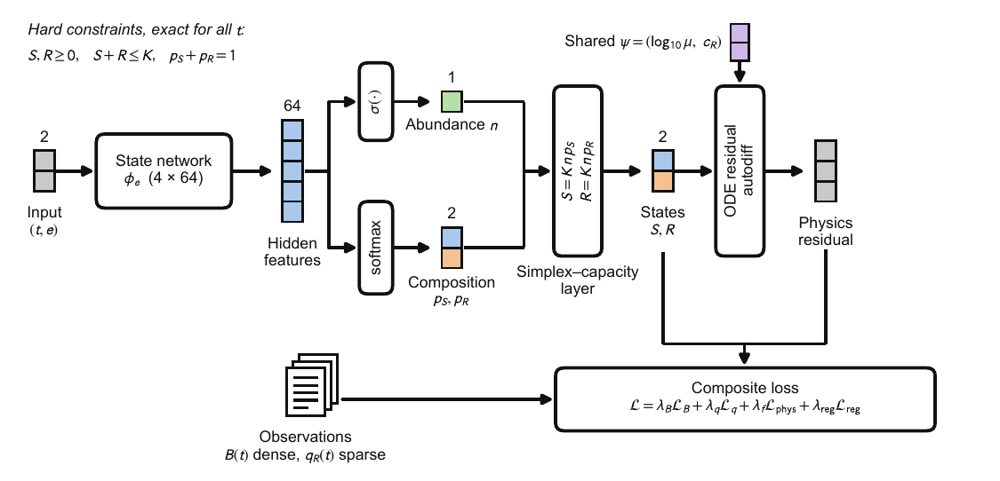
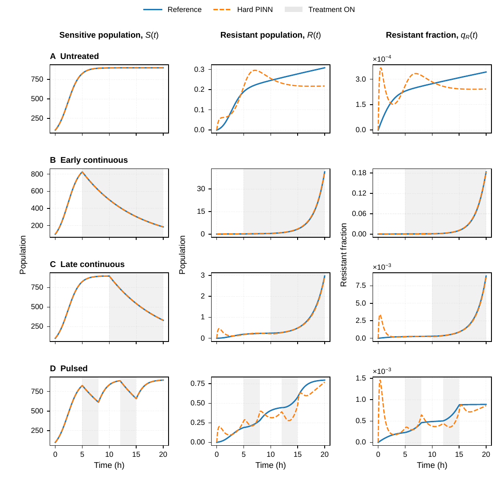
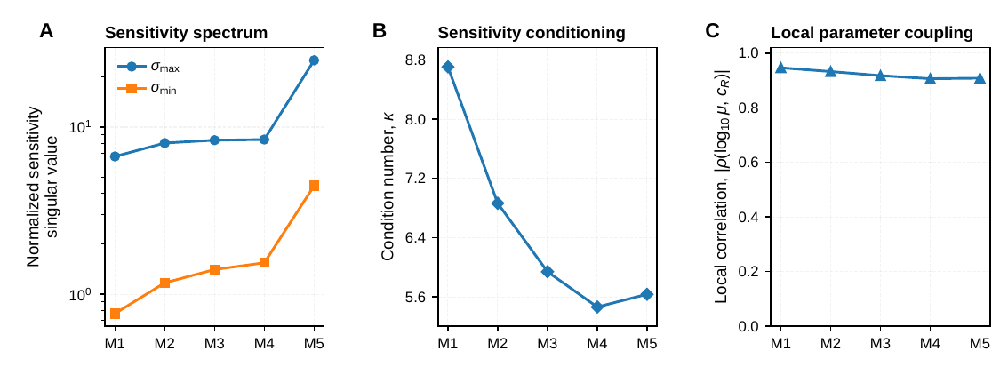
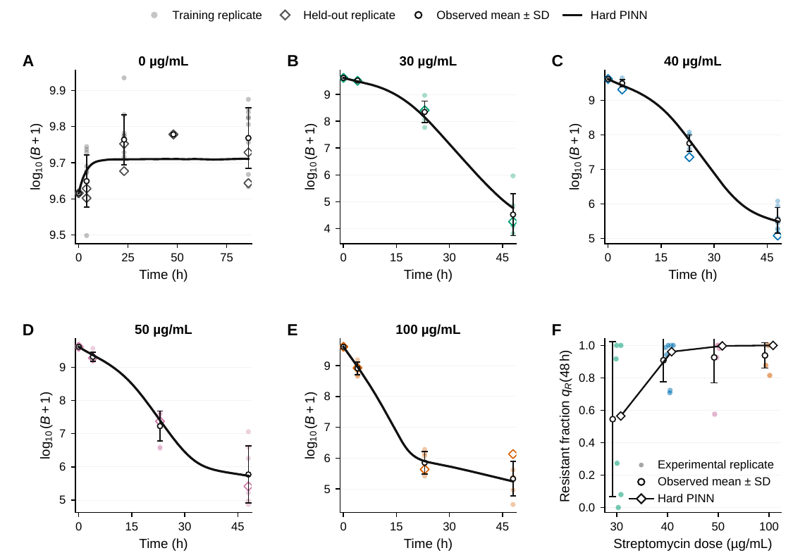
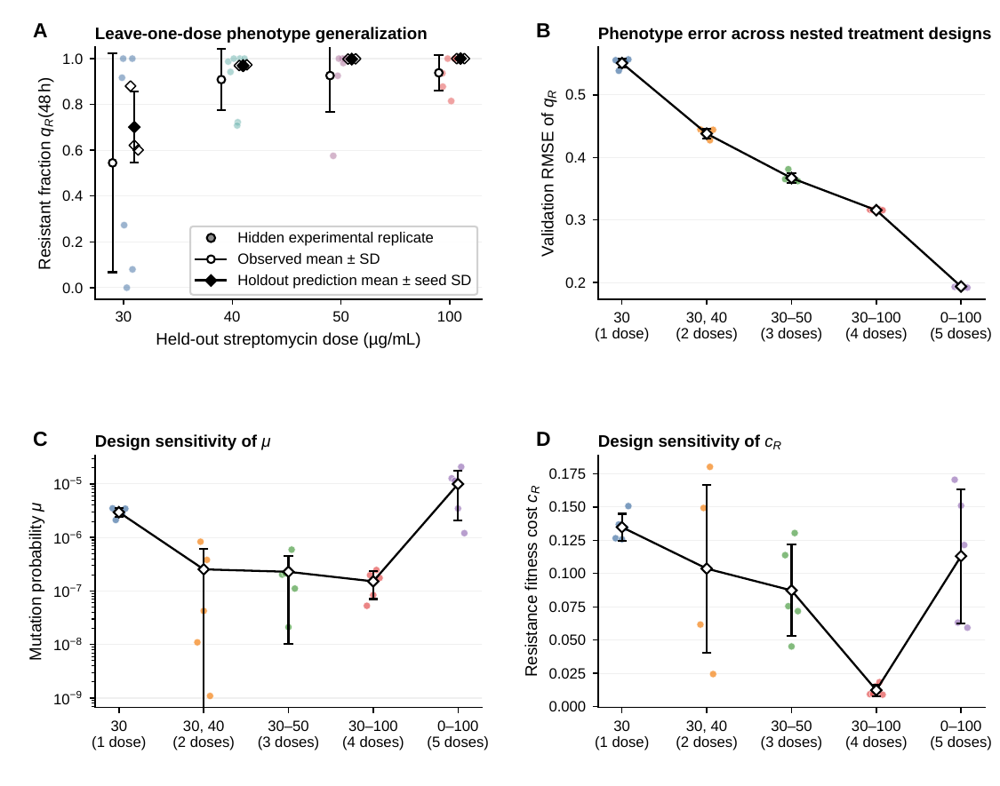
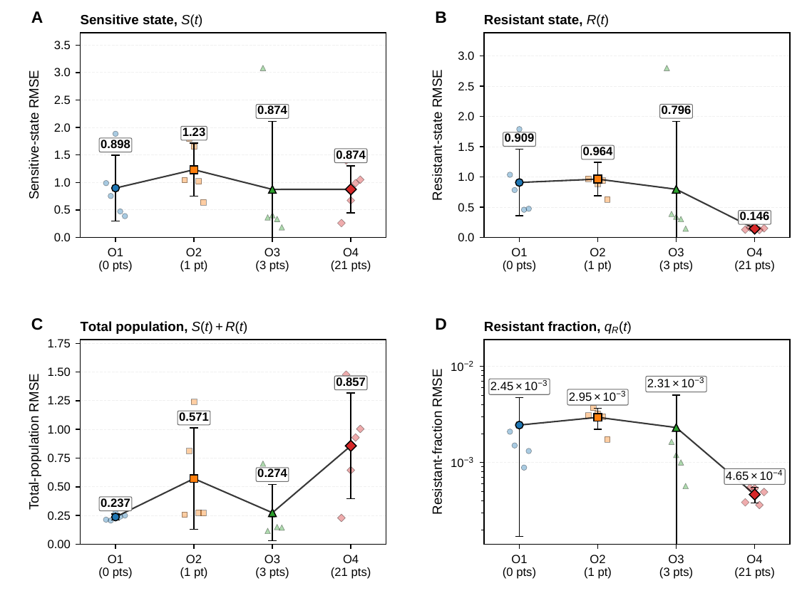
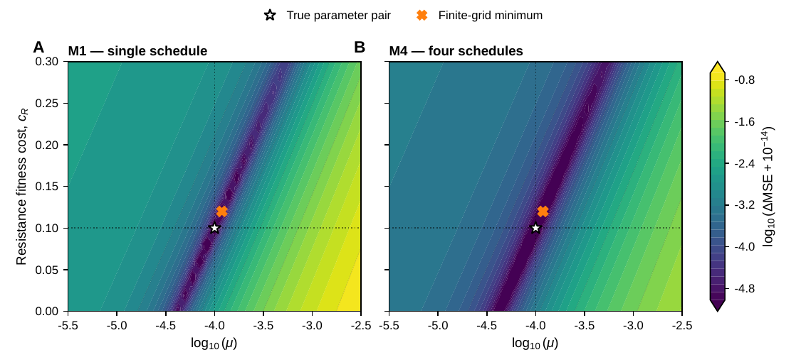
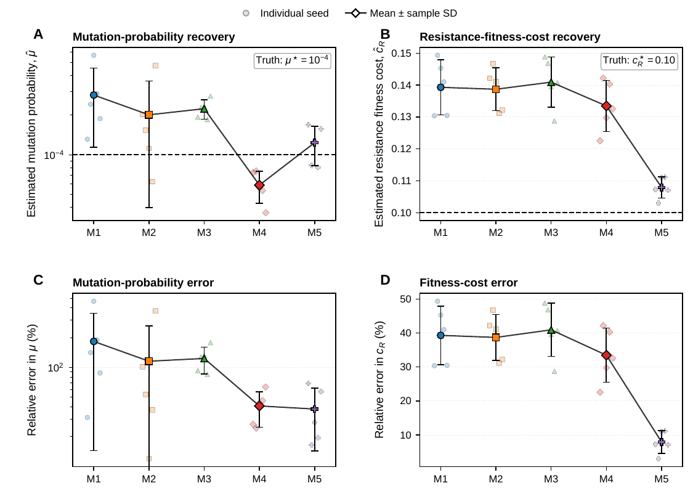
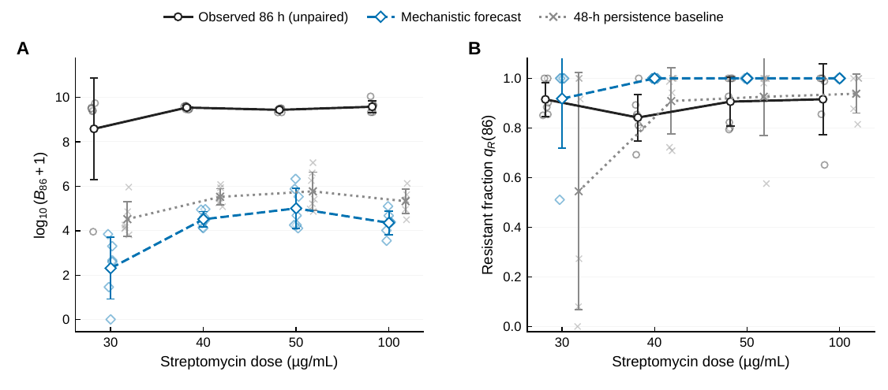

# Simplex- and capacity-preserving eco-evolutionary PINNs for antimicrobial resistance dynamics

[](https://doi.org/10.5281/zenodo.23727997)

Code accompanying the article

> Iqbal Q, Shah Z. *Simplex- and capacity-preserving eco-evolutionary physics-informed neural networks for sparse-data inference of antimicrobial resistance dynamics.* Submitted to PLOS Computational Biology (2026).

The repository reproduces every simulation, model fit, table and figure in the article and its S1 Appendix.

## Method in one paragraph

Sensitive (*S*) and resistant (*R*) bacteria follow a logistic eco-evolutionary model with drug-dependent birth and death, mutation probability *μ* and resistance cost *c<sub>R</sub>*. Experiments measure total load *B = S + R* densely but resistant fraction *q<sub>R</sub> = R/B* only sparsely. The PINN predicts a normalised abundance *n = σ(z<sub>N</sub>)* and a composition *p = softmax(z<sub>p</sub>)*, and sets *S = K n p<sub>S</sub>* and *R = K n p<sub>R</sub>*. As a result *S, R ≥ 0*, *S + R ≤ K* and *p<sub>S</sub> + p<sub>R</sub> = 1* hold exactly at every time point, not only at collocation points. One network is trained per treatment environment, and all of them share the evolutionary parameters *ψ = (log<sub>10</sub> μ, c<sub>R</sub>)*.

## Figures

Previews of the article figures, redrawn by `figures/make_all_figures.py` from the saved results in `results/`. Click a figure to open it at full size.

**Fig 1.** Proposed simplex- and capacity-preserving PINN framework. The state network outputs abundance *n* and composition (*p<sub>S</sub>*, *p<sub>R</sub>*), which the simplex–capacity layer maps to feasible states *S* and *R*. The loss combines the observations with the ODE residual evaluated using the shared parameters ψ.

[](figures/preview/Fig1.png)

**Fig 2.** Representative state reconstruction under the four-environment sparse-phenotype design.

[](figures/preview/Fig2.png)

**Fig 3.** Local identifiability geometry across nested designs M1–M5.

[](figures/preview/Fig3.png)

**Fig 4.** Experimental-data reconstruction with the inverse parameters fixed.

[](figures/preview/Fig4.png)

**Fig 5.** Experimental-data generalization and dose-design sensitivity.

[](figures/preview/Fig5.png)

**Fig 6.** Effect of phenotype-observation richness on hidden-state reconstruction.

[](figures/preview/Fig6.png)

**Fig 7.** Observation-objective geometry in the (μ, c<sub>R</sub>) plane for designs M1 and M4.

[](figures/preview/Fig7.png)

**Fig 8.** Recovery of shared evolutionary parameters across designs M1–M5.

[](figures/preview/Fig8.png)

**Fig 9.** Schedule-specific information from leave-one-schedule-out refits.

[](figures/preview/Fig9.png)

**Fig 10.** Independent validation at the unpaired treated 86-h endpoint.

[](figures/preview/Fig10.png)

## Repository layout

```
AMR-EcoEvo-PINN/
├── notebooks/
│   ├── 01_synthetic_benchmarks.ipynb   Rounds 1-4: simulation, stochastic benchmark,
│   │                                   architecture ablation, observation regimes,
│   │                                   multi-environment designs and identifiability
│   └── 02_real_data_Ramsayer.ipynb     Pseudomonas fluorescens streptomycin-rescue data:
│                                       reconstruction, leave-one-dose, dose diversity,
│                                       independent 86-h endpoint validation
├── figures/                            stand-alone scripts that redraw Fig 1-10 at PLOS size
│   ├── plos_style.py                   shared sizes, fonts (Arial, 8-11 pt) and output paths
│   ├── Fig1_framework_overview.py ... Fig10_independent_86h_validation.py
│   ├── make_all_figures.py
│   ├── preview/                        PNG previews of Fig 1-10 (shown above)
│   └── output/                         FigN.pdf (for LaTeX) and FigN.tif (for PLOS)
├── data/real/                          analysis-ready Ramsayer et al. tables (see data/README.md)
├── results/
│   ├── synthetic/                      written by notebook 01
│   └── real_data/                      written by notebook 02
├── tools/collect_results.py            copies existing local results into this layout
├── requirements.txt, environment.yml
├── CITATION.cff, .zenodo.json, LICENSE
```

## Installation

Python 3.11 or newer. The results in the article were produced with Python 3.13.11, PyTorch 2.7.1 (CUDA 11.8), NumPy 2.4.0, pandas 2.3.3, SciPy 1.16.3 and Matplotlib 3.10.8 on an NVIDIA GeForce RTX 3070 (8 GB).

```bash
git clone https://github.com/quaidiqbal11/AMR-EcoEvo-PINN.git
cd AMR-EcoEvo-PINN

# option 1: conda
conda env create -f environment.yml
conda activate amr-pinn

# option 2: pip
python -m venv .venv && source .venv/bin/activate      # Windows: .venv\Scripts\activate
pip install -r requirements.txt
```

For GPU training, install the PyTorch build that matches your CUDA version from <https://pytorch.org/get-started/locally/>. The code also runs on a CPU, but more slowly.

## Reproducing the article

Start Jupyter from the repository root (`jupyter lab`) and run the notebooks from top to bottom. Each notebook finds the repository root automatically, so no paths need editing.

### 1. Synthetic benchmarks: `notebooks/01_synthetic_benchmarks.ipynb`

| Part | Content | Output folder |
|---|---|---|
| Round 1 (Cells 1-24) | Deterministic model, four treatment schedules (untreated, early-continuous, late-continuous, pulsed), dense, sparse and noisy observations, sensitivity and convergence checks | `results/synthetic/data`, `results/synthetic/outputs` |
| Round 2 (Cells 1-18) | Gillespie stochastic simulator, ensembles, rescue probabilities, stochastic sparse-data benchmark | `results/synthetic/data/stochastic`, `results/synthetic/outputs` |
| Round 3 (Cells 1-19) | Hard-constraint PINN, architecture ablation, observation-richness regimes O1-O4 (five paired seeds) | `results/synthetic/round3/final` |
| Round 4 (Cells 1-27) | Nested multi-environment designs M1-M5, parameter recovery, local identifiability, leave-one-schedule-out refits, objective surfaces, constraint audit | `results/synthetic/round4/final` |

`QUICK_MODE = False` (Round 2, Cell 1) and `RUN_LABEL = "final"` reproduce the reported numbers. `QUICK_MODE = True` runs a short version for checking the code only, and its numbers should not be reported. Seeds are fixed in the first cell of each round.

### 2. Experimental data: `notebooks/02_real_data_Ramsayer.ipynb`

Copy the three data tables into `data/real/` (see [data/README.md](data/README.md)), then run the notebook.

| Section | Experiment | Output |
|---|---|---|
| Cells 1-7 | Data audit, hard abundance-simplex architecture, physics and observation losses, four-stage training | `results/real_data/models` |
| Cell 8 (Exp 3.7) + P1/P2 refinements | Reconstruction with inverse parameters frozen | `results/real_data/tables` |
| Cell 9 (Exp 3.8) | Leave-one-dose phenotype generalization | `results/real_data/tables` |
| Cell 10 (Exp 3.9) | Nested dose diversity | `results/real_data/tables` |
| Cell 12 (Exp 3.10) | Independent, unpaired 86-h endpoint validation (the 86-h file is read only here) | `results/real_data/tables` |
| Cell 13 | Provenance, consolidated audit, manifest | `results/real_data/reports` |

### 3. Figures: `figures/`

Once both notebooks have run:

```bash
python figures/make_all_figures.py                 # all figures
python figures/Fig6_observation_regimes.py         # or one figure
```

Each figure is written to `figures/output/` as a vector PDF and as a 600-dpi RGB TIFF with LZW compression. The TIFFs are 7.5 in wide or less with Arial text of 8 pt or more, which meets the PLOS figure requirements. Fig 1 is 300 dpi and needs no data. The figure scripts only read saved CSV tables; they do not retrain anything.

## Where each result comes from

| Article item | Notebook / cell | Figure script | Main input table |
|---|---|---|---|
| Fig 1 | n/a (schematic) | `Fig1_framework_overview.py` | none |
| Fig 2 | 01 · Round 4 Cell 20 | `Fig2_representative_M4_trajectories.py` | `round4/final/tables/round4_primary_multischedule_all_seeds_metrics.csv`, `round4/final/predictions/` |
| Fig 3 | 01 · Round 4 Cell 22 | `Fig3_identifiability_geometry.py` | `round4_identifiability_geometry_plot_values.csv` |
| Fig 4 | 02 · Cell 8 + publication-figure cell | `Fig4_real_data_reconstruction.py` | `real_data/figures/publication_ready/source_data/final_MAIN_*.csv` |
| Fig 5 | 02 · Cells 9-10 | `Fig5_generalization_design_sensitivity.py` | `final_R38_*`, `final_R39_*` tables |
| Fig 6 | 01 · Round 3 Cells 18-19 | `Fig6_observation_regimes.py` | `round3/final/tables/round3_observation_regime_all_seeds_metrics.csv` |
| Fig 7 | 01 · Round 4 Cell 24 | `Fig7_profile_surfaces.py` | `round4_profile_surfaces_M1_M4.csv` |
| Fig 8 | 01 · Round 4 Cell 19 | `Fig8_parameter_recovery.py` | `round4_primary_multischedule_all_seeds_metrics.csv` |
| Fig 9 | 01 · Round 4 Cells 23-23C | `Fig9_leave_one_schedule_out.py` | `round4_leave_one_schedule_out_metrics.csv` |
| Fig 10 | 02 · Cell 12 | `Fig10_independent_86h_validation.py` | `final_R310_*_population_forecasts_from_48h.csv` |
| Table 1 | 01 · Round 3 Cell 16 | n/a | `round3/final/tables` |
| Table 2 | 01 · Round 4 Cells 18-19 | n/a | `round4/final/tables` |
| Tables 3-5 | 02 · Cells 9, 10, 12 | n/a | `real_data/tables` |

## Data

The experimental data are from Ramsayer J, Kaltz O, Hochberg ME, *Evolutionary rescue in populations of* Pseudomonas fluorescens *across an antibiotic gradient*, Evol Appl 2013;6(4):608-16, deposited at Dryad: <https://doi.org/10.5061/dryad.c59q3> (CC0). See [data/README.md](data/README.md) for the files and columns. All synthetic data are generated by notebook 01.

## Citation

If you use this code, please cite the article above and this software archive:

> Iqbal Q, Shah Z. AMR-EcoEvo-PINN. Zenodo; 2026. https://doi.org/10.5281/zenodo.23727997

This DOI always resolves to the latest archived version; version-specific DOIs are listed on the Zenodo record.

## License

MIT; see [LICENSE](LICENSE).

## Contact

Quaid Iqbal, College of Science and Engineering, Hamad Bin Khalifa University, Doha, Qatar · quiq89904@hbku.edu.qa · ORCID [0009-0006-0503-6389](https://orcid.org/0009-0006-0503-6389)
